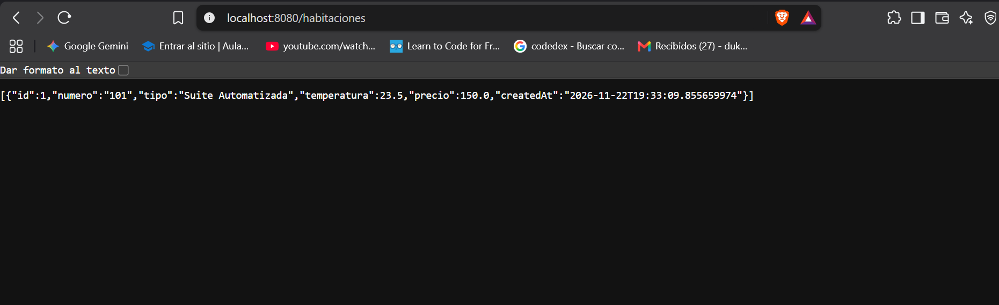
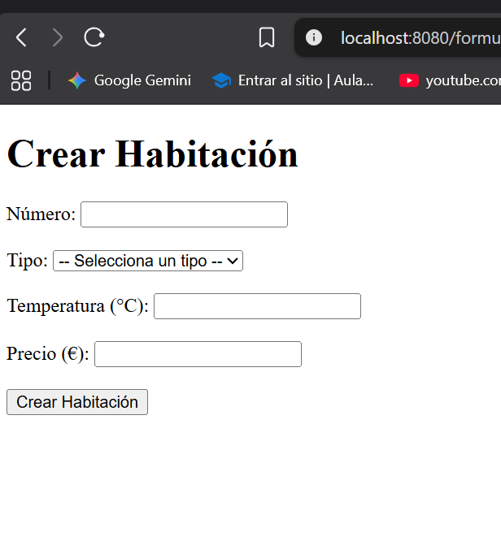
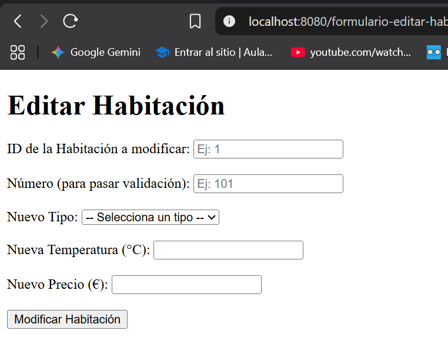
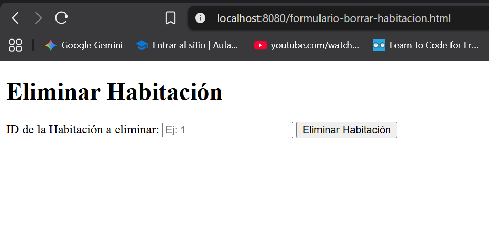
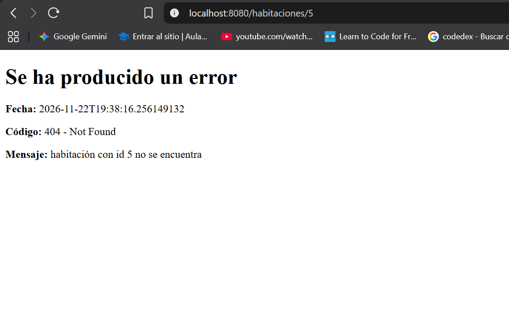

# 2. Implementación y Pruebas

## Entorno de desarrollo y herramientas

| Categoría                | Herramienta / Tecnología           | Versión / Detalle                    |
|--------------------------|------------------------------------|--------------------------------------|
| **Sistema Operativo**    | Windows 11 + WSL (Debian)          | Entorno de ejecución Linux           |
| **IDE**                  | Visual Studio Code                 | Extension Pack for Java              |
| **Lenguaje**             | Java (OpenJDK)                     | 17                                   |
| **Framework**            | Spring Boot (Web MVC + Validation) | 4.1.1                                |
| **Mapeo DTOs**           | MapStruct                          | 1.6.3                                |
| **Productividad**        | Lombok                             | Integrado con Maven                  |
| **Compilación**          | Maven Wrapper (`./mvnw`)           | Sin instalación global               |
| **Control de versiones** | Git + Git Flow + GitHub            | Ramas `main`, `develop`, `feature/*` |
| **Documentación**        | Markdown                           | Carpeta `doc/` + `README.md`         |

## Implantación / Puesta en producción

La aplicación se empaqueta y ejecuta de forma autocontenida mediante el servidor Tomcat embebido de Spring Boot:

```bash
./mvnw spring-boot:run
```

Para generar el artefacto desplegable (`.jar`) listo para producción:

```bash
./mvnw clean package
java -jar target/shotel-0.0.1-SNAPSHOT.jar
```

El servicio queda expuesto en `http://localhost:8080`. La persistencia simulada (`HabitacionRepositoryMockImpl`) inicializa automáticamente 3 habitaciones en memoria a través de `HabitacionFactory`.

---

## Capturas de la ejecución de la funcionalidad y pruebas

### Listado inicial (`GET /habitaciones` — PR-01)


### Crear, editar y eliminar (`POST` / `PUT` — PR-02 y PR-04)




### Manejo global de errores (`404 Not Found` — PR-06)


### Resultado de la ejecución del plan de pruebas

| ID    | Caso probado        | Estado   | Observaciones                                                           |
|-------|---------------------|----------|-------------------------------------------------------------------------|
| PR-01 | Listado inicial     | Superada | Devuelve las 3 habitaciones de `HabitacionFactory` en JSON.             |
| PR-02 | Alta válida         | Superada | Asigna ID correlativo y devuelve `201 Created`.                         |
| PR-03 | Alta inválida       | Superada | Interceptada por `@Valid` y `GlobalExceptionHandler` (`400`).           |
| PR-04 | Edición válida      | Superada | Actualiza los campos de la habitación `1` vía `_method=PUT`.            |
| PR-05 | Borrado válido      | Superada | Elimina los IDs `2` y `3` vía `_method=DELETE` (`204`).                 |
| PR-06 | Borrado inexistente | Superada | Lanza `HabitacionNotFoundException` y devuelve `404 Not Found`.         |

---

## Elementos destacables del desarrollo

- **Formularios HTML completos para `POST`, `PUT` y `DELETE`:** además del alta y borrado, se añadió `formulario-editar-habitacion.html` apoyándose en `HiddenHttpMethodFilter` (`spring.mvc.hiddenmethod.filter.enabled=true`) para enviar peticiones `PUT` y `DELETE` desde HTML puro.
- **Problema encontrado y resuelto (`415 Unsupported Media Type`):** al enviar formularios HTML clásicos (`application/x-www-form-urlencoded`) contra un controlador anotado con `@RequestBody`, Spring rechazaba la petición al esperar JSON. Se resolvió eliminando `@RequestBody` en los endpoints consumidos por los formularios y reiniciando el contexto de Spring Boot.
- **Flujo profesional con Git Flow:** todo el desarrollo y la documentación se aislaron en ramas `feature/*` antes de integrarse en `develop`.